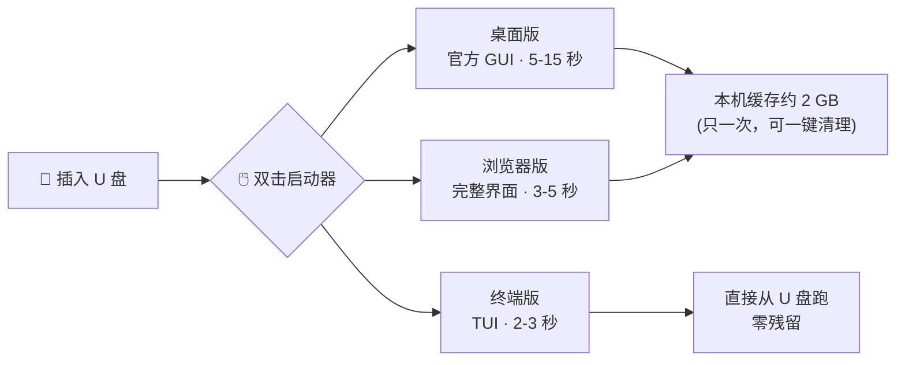
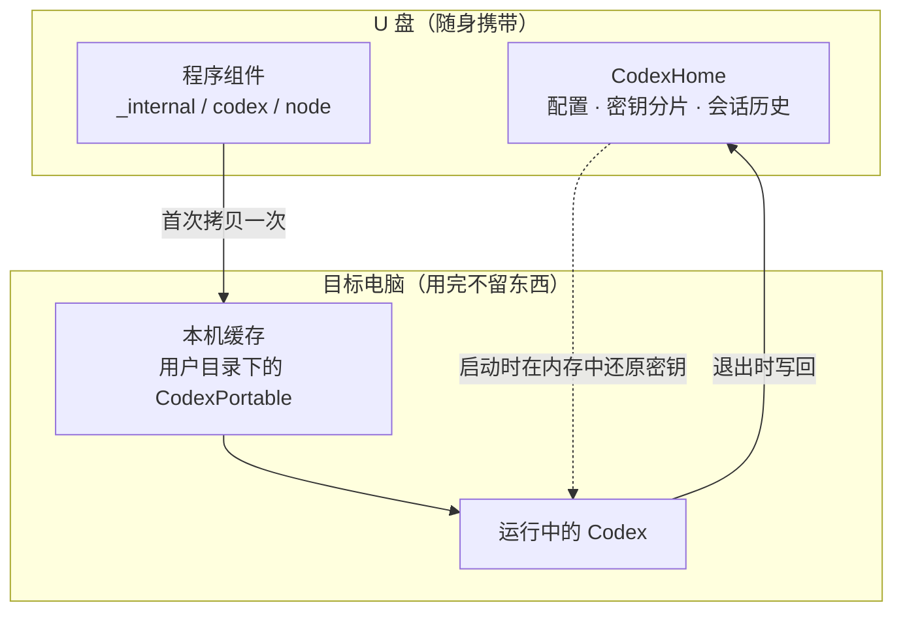

# Codex 便携版 · Windows U 盘

**把一个完整的 Codex 装进 U 盘。** 插到任意一台 64 位 Windows 10 / 11 电脑上双击就能用，
配置、API 密钥、会话历史全部跟着 U 盘走 —— 目标电脑**不用装任何运行库**，
程序只在本机留一份可一键清理的缓存。

[中文](README.md) · [English](README.en.md) · [装配指南](docs/01-装配指南.md) · [踩坑记录](docs/03-踩坑记录.md) · [安全与密钥](docs/05-安全与密钥.md)

---

## 它是怎么工作的

## 三步就能用

**① 把这个仓库放到 U 盘上**

    git clone https://github.com/liujiarui4777/codex-usb-portable.git E:\codex-usb-portable

（不想用 git？直接下载 ZIP 解压到 U 盘也可以）

**② 双击 `setup\一键装配.cmd`**

脚本会从各上游官方地址自动下载并摆放所有组件（约 1.5 GB），装完自动自检。

- 🌐 **自动测速选源**：GitHub 在大陆直连常常只有几十 KB/s，脚本会先给几个公共镜像各测 5 秒，
  挑最快的那个下载（实测 0.6-2.6 MB/s，比直连快几十倍）。
- 🔒 **官方哈希校验**：下载完用 GitHub Release API 给出的官方 SHA-256 校验，
  所以即使经过第三方镜像，拿到的字节也和官方完全一致。
- 🚫 不想走第三方镜像：加 `-NoMirror`；想指定自己的镜像：`-Mirror https://xxxx/`。

想要更小更快可以改用：

    powershell -ExecutionPolicy Bypass -File setup.ps1 -Minimal      # 只装终端版，约 160 MB

**③ 配好密钥，开跑**

双击 `CodexHome\设置API密钥.cmd` 把 API Key 存成分片，
然后双击 `【Windows】启动 Codex(桌面版).cmd`。

> 🔑 **不想把 Key 放在 U 盘上？** 在 U 盘根目录开个终端执行 `codex login`，
> 用官方账号登录一次，凭据存进 `CodexHome\auth.json`，同样跟着 U 盘走。

## 三个入口

| 入口 | 冷启动 | 热启动 | 适合 |
|---|---|---|---|
| **桌面版**（官方 GUI） | 约 1-3 分钟（首次建缓存） | **5-15 秒** | 日常使用，界面和本机装的 Codex 一样 |
| **终端版**（TUI） | 约 3-15 秒 | **2-3 秒** | 追求速度、大仓库里改代码 |
| **浏览器版** | 约 3-5 秒 | 3-5 秒 | 喜欢网页界面（需 Node + web 包） |

外加两个体检工具：

- `（可选）检查这台电脑能否运行.cmd` —— 插到新电脑先跑一次，自动体检并给结论
- `（可选）收集本机环境档案.cmd` —— 采集这台电脑的硬件/兼容性/实测 U 盘速度写回 U 盘

## U 盘上长什么样

    E:\
    ├─ 【Windows】启动 Codex(桌面版).cmd      ← 主入口
    ├─ 【Windows】启动 Codex(终端).cmd        ← 秒开
    ├─ 【Windows】启动 Codex(浏览器界面).cmd   ← 可选
    ├─ （可选）检查这台电脑能否运行.cmd
    ├─ （可选）清理本机缓存.cmd                ← 清掉留在本机的缓存
    ├─ （可选）收集本机环境档案.cmd
    ├─ check-pc.ps1 / collect-pc.ps1          ← 上面两个工具的本体
    ├─ _internal\   桌面版程序 + launch-desktop.ps1
    ├─ codex\       Codex 命令行版 + launch-cli.ps1
    ├─ web\ node\   浏览器界面 + 便携 Node        （可选）
    ├─ python\      便携 Python + 库              （可选，Excel/PPT/PDF）
    ├─ tools\       pandoc / ffmpeg / poppler / uv / jq（可选）
    └─ CodexHome\   配置 · 密钥分片 · 技能 · 会话历史（核心）

## 安全与隐私

这个仓库**刻意不含**两类东西，你 fork 或提 PR 时也请保持这样：

| 不含 | 为什么 |
|---|---|
| **任何第三方二进制** | 桌面版程序约 1.9 GB / 7000+ 个文件，单个 exe 就超过 GitHub 的 100 MB 上限；而且重新分发 Codex / 上游重打包版本并不合规 —— 所以改成"装配脚本按需从上游官方下载" |
| **任何密钥 / 账号 / 对话记录** | 源码里没有密钥；`*.dat`（密钥分片）、`auth.json`、`sessions/`、日志都在 `.gitignore` 里排除；仓库是从干净快照新建的，历史提交里也没有 |

关于运行时的安全设计：

1. **密钥不以明文存在 U 盘上** —— 拆成 3 段各自混淆后 Base64 存放，启动时在内存里还原，
   只在运行期间短暂写入 `auth.json`，退出即删除。
   ⚠️ 但要说清楚：**这是混淆，不是加密**。能长期接触 U 盘的人仍可能还原出来。
   更稳妥的做法：**只放一个额度可控、能随时吊销的 Key**，或给整个 U 盘开 BitLocker To Go。
2. **不干扰本机** —— 启动器把 `APPDATA` / `LOCALAPPDATA` 重定向到自己的缓存目录，
   不会读你本机已安装 Codex 的配置，也不会污染你的用户配置。
3. **不联网、不上报** —— 所有脚本都是本地文件操作；只有你在装配时才会去上游下载程序。
   （装配时若走了第三方镜像，镜像方能看到"你在下载哪个公开文件"和你的 IP；
   但内容会用官方 SHA-256 校验，**镜像无法篡改**。）
4. 浏览器界面只监听 `127.0.0.1`，不对外开放。

## 常见问题

**Q：为什么不直接提供打包好的完整 U 盘镜像？**
A：单文件超过 100 MB 就推不上 GitHub；桌面版有 1.9 GB。所以做成一键装配：脚本按官方地址下载，
比塞进仓库更合规、也永远是最新版。

**Q：插到别人的电脑上安全吗？**
A：脚本会隔离自己的环境，不读本机 Codex 的配置；但会在本机留下约 2 GB 缓存
（用户目录下），公用电脑用完请双击「清理本机缓存」。

**Q：第一次启动为什么要等 1-3 分钟？**
A：桌面版有 7800 多个文件，U 盘随机读先天慢（十几 MB/s）。启动器改成先拷贝到本机再运行，
所以**只慢这一次**，之后都是 5-15 秒。终端版文件极少，不需要缓存，一直是 2-3 秒。

**Q：能在 Mac 上用吗？**
A：本仓库只覆盖 Windows。思路是一样的（`CODEX_HOME` 指向 U 盘 + 官方 CLI），但脚本要重写。

更多问题见 [docs/04-常见问题](docs/04-常见问题.md)。

## 文档

| 文档 | 内容 |
|---|---|
| [01-装配指南](docs/01-装配指南.md) | 每个组件的官方地址、解压后放哪、怎么精简 |
| [02-原理与设计](docs/02-原理与设计.md) | 启动流程、缓存策略、环境隔离，以及为什么这么设计 |
| [03-踩坑记录](docs/03-踩坑记录.md) | 13 个实测踩到的坑（SxS、单实例、编码、文件系统…） |
| [04-常见问题](docs/04-常见问题.md) | 报错对照表：401 / 未知模型 / 一闪而过 / 并行配置不正确… |
| [05-安全与密钥](docs/05-安全与密钥.md) | 密钥怎么存、能防到什么程度、更安全的替代方案 |

## 已知限制

- 只支持 **64 位 Windows 10 / 11**（ARM64 未验证）。
- 桌面版首次在某台电脑上要拷约 2 GB，入门 U 盘大约 1-3 分钟（这块盘写小文件确实慢）。
- 程序缓存**必须**放用户目录，不能放 `AppData`（会被 Windows 的 SxS 机制拒绝加载，见踩坑记录坑 1）。
- 浏览器界面这个入口**没有做过充分实测**，欢迎反馈问题。

## 致谢与免责

- 本仓库的脚本与文档：**MIT**（见 [LICENSE](LICENSE)）。
- 仓库**不含**以下第三方组件，装配时从它们的官方发布获取，请遵守各自许可：
  [openai/codex](https://github.com/openai/codex) ·
  [lusipad/unofficial-codex-app-offline](https://github.com/lusipad/unofficial-codex-app-offline)（**非官方**重打包，请自行判断风险）·
  [Node.js](https://nodejs.org/) · [Python](https://www.python.org/) ·
  [pandoc](https://pandoc.org/) · [ffmpeg](https://ffmpeg.org/) ·
  [poppler-windows](https://github.com/oschwartz10612/poppler-windows) · [uv](https://github.com/astral-sh/uv) · [jq](https://github.com/jqlang/jq)
- 本项目与 OpenAI 及上述任何组织**没有关联**，是本人为了让自己那块 U 盘好用而写的一套启动器，
  整理后开源，希望有同样需求的人少踩坑。
